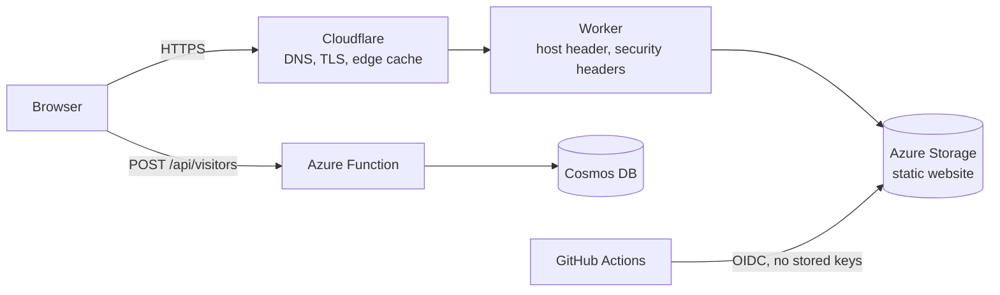

# Cloud Resume Challenge (Azure) — Frontend

My resume as a static website on Azure Storage, deployed by GitHub Actions. It calls a serverless API ([backend repo](https://github.com/adye1/crc-backend)) to show a live visitor count.

**Live site:** https://adamdye.dev/

## Architecture

## Custom domain and edge

`adamdye.dev` is registered and served through Cloudflare's free plan. The Azure storage endpoint rejects requests that carry a foreign Host header, and the free plan cannot rewrite it with an Origin Rule (Enterprise only). A small Worker in [`edge/`](edge/) does the proxying instead:

- forwards requests to the storage site (the Worker's `fetch()` sets the correct Host header)
- redirects `www` and plain `http://` to `https://adamdye.dev`
- allows only GET and HEAD
- adds HSTS, a strict Content-Security-Policy, `nosniff`, a referrer policy and a permissions policy
- caches static files at the edge for 5 minutes, so site updates appear without a manual purge

Deploy it with `npx wrangler deploy` from `edge/` after `wrangler login`. The Worker is not in the GitHub Actions pipeline yet, because that needs a scoped Cloudflare API token.

I chose Cloudflare over Azure Front Door because Front Door Standard costs about $35 a month before usage.

## Pipeline

Every push to `main`:

1. Logs in to Azure with OIDC, using a managed identity scoped to this project's resource group
2. Applies `infra/main.bicep` (the storage account)
3. Enables static website hosting and uploads `site/`
4. Smoke test: the page loads and contains the counter element

## Repository layout

| Path | Purpose |
|---|---|
| `site/index.html`, `site/style.css` | The resume, plain HTML and CSS with dark-mode and print styles |
| `site/counter.js` | Fetches the visitor count from the API |
| `infra/main.bicep` | Storage account |
| `.github/workflows/` | Deploy pipeline and CodeQL |

## Decisions and trade-offs

- **Azure Storage static hosting** rather than a managed static-site service, to work through the storage, HTTPS and DNS building blocks directly (the point of the challenge).
- **Plain HTML and CSS.** The challenge values the cloud plumbing over front-end frameworks.
- **Signed commits are required on `main`** by a repository ruleset.

## Not done yet

- Deploying the Worker from the pipeline with a scoped API token
- SPF and DMARC records that reject email spoofed from the domain
- Browser-level end-to-end test with Cypress
