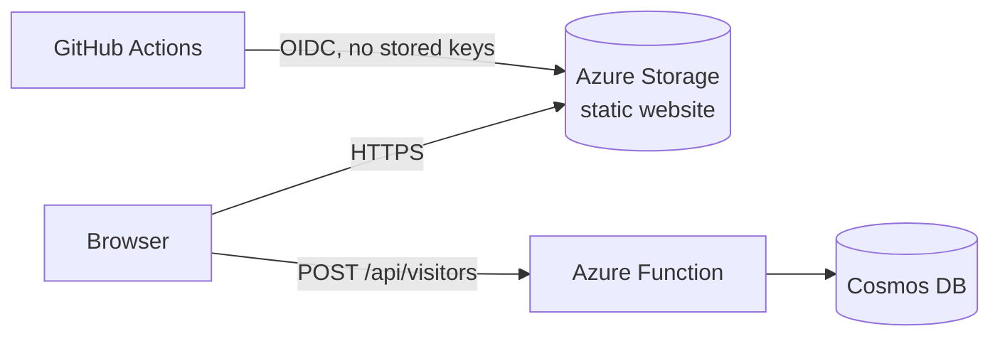

# Cloud Resume Challenge (Azure) — Frontend

My resume as a static website on Azure Storage, deployed by GitHub Actions. It calls a serverless API ([backend repo](https://github.com/adye1/crc-backend)) to show a live visitor count.

**Live site:** https://stcrcfront99661.z13.web.core.windows.net/ (custom domain still to come)

## Architecture

## Pipeline

Every push to `main`:

1. Logs in to Azure with OIDC, using a managed identity scoped to this project's resource group
2. Applies `infra/main.bicep` (the storage account)
3. Enables static website hosting and uploads `site/`
4. Smoke test: the page loads and contains the counter element

## Repository layout

| Path | Purpose |
|---|---|
| `site/index.html`, `site/style.css` | The resume, plain HTML and CSS with dark-mode and print styles |
| `site/counter.js` | Fetches the visitor count from the API |
| `infra/main.bicep` | Storage account |
| `.github/workflows/` | Deploy pipeline and CodeQL |

## Decisions and trade-offs

- **Azure Storage static hosting** rather than a managed static-site service, to work through the storage, HTTPS and DNS building blocks directly (the point of the challenge).
- **Plain HTML and CSS.** The challenge values the cloud plumbing over front-end frameworks.
- **Signed commits are required on `main`** by a repository ruleset.

## Not done yet

- Custom domain and HTTPS in front of the storage endpoint (planned with Azure Front Door, or a cheaper alternative after checking pricing)
- Cache purge step, which applies once a CDN is in front
- Browser-level end-to-end test with Cypress
